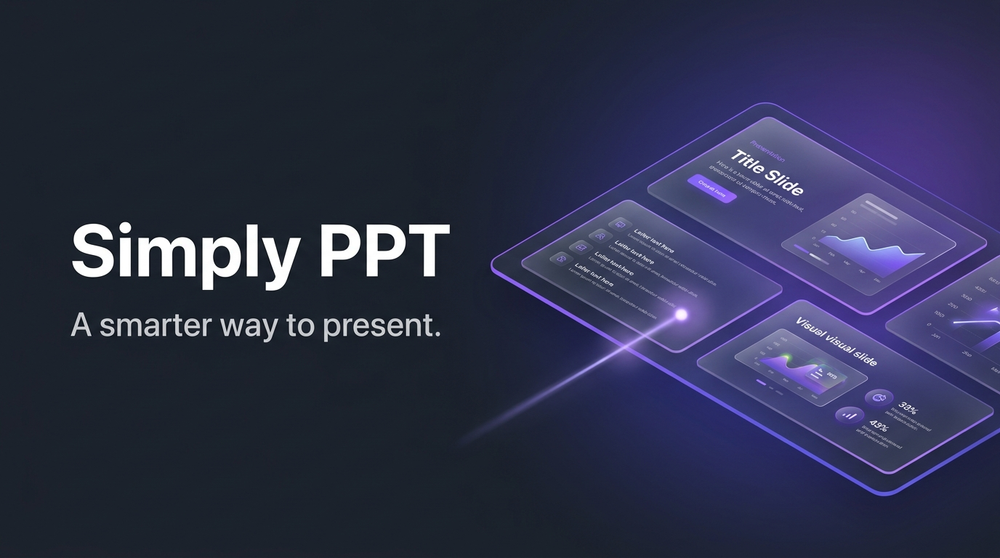

# Simply PPT — A Smarter Way to Present



> **Simply PPT** is a modern, desktop-first presentation control platform that lets you deliver presentations locally on your machine while pairing with mobile controllers across any cellular or Wi-Fi network via Supabase Realtime signaling.

---

## 1. Product Description

Traditional presentation remotes require physical dongles, expensive clickers, or unreliable local Wi-Fi pairing where presentation files are either hosted on cloud servers or both devices must share the same network subnet.

**Simply PPT reimagines presentation control:**
- **Local-First Privacy:** Presentation slides (PDF) remain strictly on your local computer. Presentations are never uploaded to Supabase or third-party cloud storage.
- **Cross-Network Pairing:** Pair your mobile device from anywhere in seconds using a single-use 6-digit pair code. Works seamlessly whether your laptop is on university/corporate Wi-Fi and your phone is on cellular 4G/5G.
- **Host-Controlled Security:** Every incoming connection request must be visually reviewed and explicitly approved by the presenter before control is granted.
- **Offline Resilience:** If your internet connection drops, local slide navigation, keyboard controls, and fullscreen presentations continue operating without interruption.

---

## 2. Main Features

### 🖥️ Desktop Presentation Engine
- **Hardware-Accelerated Slide Rendering:** Crisp, high-DPI PDF page rendering powered by PDF.js with aspect ratio preservation.
- **Clean Stage Mode:** Zero distracting UI during presentation — fullscreen presentation displays only the slide canvas with an auto-hiding HUD that smoothly reveals upon cursor movement.
- **Stage Shading Modes:** Instant blackout (`B`) and whiteout (`W`) to draw audience focus back to the speaker.
- **Direct Navigation:** Jump directly to any slide index via quick dialog (`G`) or slide picker.
- **Customizable Aesthetics:** Configurable stage background colors (Pure Black `#000000`, Obsidian Slate `#09090b`, Deep Violet `#0f0a1e`, Studio Dark `#18181b`) and slide transition effects (Instant Cut, Smooth Fade, Slide Push).

### ⚡ Cross-Network Mobile Pairing
- **Single-Use 6-Digit Codes:** Cryptographically secure 6-digit numeric codes generated with `crypto.getRandomValues`.
- **3-Minute Expiration:** Real-time countdown timer invalidates codes automatically after 180 seconds.
- **Host Approval Dialog:** Desktop host reviews the device name and ID with "Approve" and "Decline" actions.
- **Granular Session Revocation:** Disconnect or revoke any paired controller at any moment.

### 📱 Mobile Android Remote Controller (Phase 2 Delivered)
Full native Android companion controller in [`apps/mobile`](apps/mobile) supporting 4 operating modes:
1. **Remote Mode:** Intuitive Next/Previous buttons, slide jumping, elapsed presentation timer, and instant Blackout (`B`) / Whiteout (`W`) stage shading.
2. **Annotation Mode:** Real-time synchronized freehand pen drawings, highlighters, and instant canvas clearing (`CLEAR_ANNOTATION`).
3. **Presenter Mode:** Smooth virtual laser pointer tracking (`LASER_POINTER` 60 Hz normalized coordinates) and regional canvas zoom (1.0x to 5.0x).
4. **Speak Only Mode:** Hands-free Indonesian voice recognition strictly supporting 3 voice triggers with duplicate command suppression:
   - `"Lanjut slide"` &rarr; `NEXT_SLIDE`
   - `"Slide sebelumnya"` &rarr; `PREVIOUS_SLIDE`
   - `"Slide [number]"` &rarr; `GO_TO_SLIDE` (e.g. *"Slide lima"* &rarr; Slide 5)

### 💾 Local Presentation Library & History
- Browser IndexedDB persistence: presentations and presentation logs are cached on-device for instant offline recall.
- Comprehensive session history recording duration, slides viewed, and paired device metrics.

---

## 3. Architecture Overview

```
┌─────────────────────────────────────────────────────────────┐
│                       DESKTOP HOST                          │
│                                                             │
│  ┌───────────────────────┐       ┌───────────────────────┐  │
│  │ Local PDF Presentation│       │  IndexedDB Database   │  │
│  │ (Never Leaves Laptop) │       │ (Offline Library/Logs)│  │
│  └───────────┬───────────┘       └───────────────────────┘  │
│              │                                              │
│              ▼                                              │
│  ┌───────────────────────────────────────────────────────┐  │
│  │           Presentation Stage & Canvas Engine          │  │
│  │    (On-demand PDF.js renderer + Laser & Annotations)  │  │
│  └───────────────────────────▲───────────────────────────┘  │
│                              │                              │
│                 Host Approval & Revocation                  │
│                              │                              │
└──────────────────────────────┼──────────────────────────────┘
                               │
                Supabase Realtime Broadcast & RLS
               (Only signaling & control coordinates)
                               │
                               ▼
┌─────────────────────────────────────────────────────────────┐
│             MOBILE CONTROLLER (ANDROID APK)                 │
│                                                             │
│   • Remote Mode     • Annotation Mode                       │
│   • Presenter Mode  • Speak Only (Indonesian voice)         │
│   • Expo SecureStore (Hardware-Backed Keystore / AES-GCM)   │
└─────────────────────────────────────────────────────────────┘
```

---

## 4. Mobile Android Controller (Phase 2)

The official **Simply PPT Android Controller** is a native companion application built with React Native 0.76.6, Expo SDK 52, and TypeScript. It turns any Android smartphone into a zero-latency presentation clicker, digital whiteboard annotator, precision laser pointer, and Indonesian voice remote.

### 📦 Pre-Built APK Deliverable
A production-ready, signed Android APK is available in the repository:
- **Download Path:** [`artifacts/simply-ppt-android.apk`](artifacts/simply-ppt-android.apk)
- **Target Package:** `com.hiro.simplyppt`
- **Minimum Android Version:** Android 7.0 (API 24)
- **Target Android Version:** Android 14 / 15 (API 34/35)
- **Architecture Support:** Universal APK supporting `arm64-v8a`, `armeabi-v7a`, `x86`, and `x86_64`

### 🎮 The 4 Operating Modes

1. **Remote Mode (`/modes/remote`):**
   - Extra-large tactile Next and Previous trigger touchpads with native haptic pulses (`Expo Haptics`).
   - Slide selector drawer with direct slide jump navigation.
   - Live presentation timer tracking total speech elapsed time.
   - Instant Stage Shading switches: Blackout (`B`) and Whiteout (`W`).

2. **Annotation Mode (`/modes/annotation`):**
   - Touch canvas capturing freehand drawing paths.
   - Normalized coordinate system `[0.0, 1.0]` for cross-resolution desktop rendering.
   - Dual tool modes: Pen (opaque stroke) and Highlighter (semi-transparent 40% alpha with wide brush).
   - High-performance gesture throttling (~30-60 Hz) prevents network broadcast flooding.
   - Synchronized undo and "Clear All" board wipe commands.

3. **Presenter Mode (`/modes/presenter`):**
   - High-precision virtual laser pointer touchpad transmitting normalized `(x, y)` laser coordinates at ~60 Hz.
   - Smooth slide preview thumbnails and contextual speaker notes.
   - Regional slide viewport zoom (1.0x to 5.0x magnification).

4. **Speak Only Mode (`/modes/speak-only`):**
   - Hands-free, speech-driven presentation control.
   - Real-time animated audio visualizer waveform reflecting microphone input volume.
   - Strict Indonesian speech intent parser with duplicate command suppression:
     - `"Lanjut slide"` &rarr; `NEXT_SLIDE`
     - `"Slide sebelumnya"` &rarr; `PREVIOUS_SLIDE`
     - `"Slide [number]"` &rarr; `GO_TO_SLIDE` (e.g. *"Slide lima"* &rarr; Slide 5)
   - Zero generic AI chatbot slop or unapproved conversational voice triggers.

### 🔒 Zero-Trust Mobile Security Architecture
- **Hardware-Backed Secret Storage:** Controller session tokens and client identifiers are encrypted at rest using `Expo SecureStore` (Android Keystore System backed by Keyguard/TEE). Plaintext tokens are never stored in `AsyncStorage` or localStorage.
- **Mandatory Host Approval:** Inputting the 6-digit pair code places the phone into an Approval Radar countdown state (180s TTL). Slide control is strictly forbidden until the host clicks "Approve" on the desktop.
- **Immediate Revocation:** If the presenter revokes the phone on the desktop host, subsequent mobile commands are immediately rejected by PostgreSQL RLS policies.
- **Network Agnostic:** Operates reliably across segregated subnets (e.g., Laptop on Campus Wi-Fi, Phone on 5G Cellular) via Supabase Realtime WebSocket signaling.

### 🛠️ Mobile Setup & Local Development

Prerequisites:
- **Node.js:** v20.x or higher
- **JDK:** OpenJDK 17
- **Android SDK:** Platform 34, Build Tools 34.0.0, NDK 26.1.10909125, CMake 3.22.1

Run in Development:
```bash
# Navigate to mobile app
cd apps/mobile

# Install dependencies
npm install

# Start Expo dev server with Metro bundler
npm start

# Run directly on connected Android device/emulator
npm run android
```

Run Mobile Automated Tests:
```bash
cd apps/mobile
npm test
```
*Executes unit tests, protocol integration tests, and E2E workflow simulations (21 passing tests across 3 suites).*

Build Release APK:
```bash
cd apps/mobile/android
./gradlew assembleRelease
# Output generated at: apps/mobile/android/app/build/outputs/apk/release/app-release.apk
```

---

## 5. Tech Stack

- **Framework:** Next.js (App Router, Turbopack, React 19)
- **Language:** TypeScript (Strict Mode)
- **Styling:** Tailwind CSS 4, Lucide Icons, Glassmorphic CSS Design System
- **PDF Engine:** PDF.js (`pdfjs-dist`) with local Web Worker execution
- **Cloud Signaling:** Supabase PostgreSQL, Supabase Realtime Broadcast, PostgreSQL Row Level Security (RLS)
- **Local Storage:** IndexedDB via `idb`
- **Validation:** Zod schemas
- **Testing:** Vitest, React Testing Library, Jest DOM, JSDOM
- **Package Manager:** pnpm

---

## 5. Requirements

- **Node.js:** v20.x or higher (tested on Node v24)
- **pnpm:** v9.x or higher (or `corepack enable pnpm`)
- **Modern Web Browser:** Chrome, Edge, Firefox, Brave, or Safari with HTML5 Fullscreen API support

---

## 6. Installation

Clone the repository and install dependencies using `pnpm`:

```bash
git clone https://github.com/Hiro778/simply-ppt.git
cd simply-ppt
pnpm install
```

---

## 7. Local Development

Start the development server on localhost:

```bash
pnpm dev
```

Open [http://127.0.0.1:3000](http://127.0.0.1:3000) in your web browser.

> [!NOTE]
> By default, the application runs in **Local / Offline Mode** without requiring any Supabase credentials. Local presentation rendering, recent presentations, history logging, and the built-in mobile simulator work out-of-the-box.

---

## 8. Environment Configuration

To enable live cross-network cloud pairing with Supabase:

1. Copy `.env.example` to `.env.local`:
   ```bash
   cp .env.example .env.local
   ```
2. Update the environment variables:
   ```ini
   NEXT_PUBLIC_SUPABASE_URL="https://your-project-id.supabase.co"
   NEXT_PUBLIC_SUPABASE_ANON_KEY="eyJhbGciOiJIUzI1NiIsInR5cCI6IkpXVCJ9..."
   ```

> [!CAUTION]
> Never put your `service_role` key into client-side environment variables. Only the public anonymous key (`anon`) is required.

---

## 9. Supabase Configuration & Complete Pairing Walkthrough

Follow this step-by-step guide to configure Supabase from scratch and establish a secure, cross-network pairing session:

### Step 1: Create Supabase Project
1. Log in to [supabase.com](https://supabase.com) and click **"New Project"**.
2. Select an organization, name your project (e.g., `simply-ppt-prod`), choose your nearest database region, and generate a strong database password.
3. Once initialized, navigate to **Project Settings &rarr; API**.
4. Note your **Project URL** (`https://<project-ref>.supabase.co`) and **`anon` `public` API key**.
   *(Never use or reveal the `service_role` key).*

### Step 2: Apply Database Schema & Security Migrations
1. Open the **SQL Editor** in your Supabase Dashboard.
2. Open [`supabase/schema.sql`](supabase/schema.sql) (or migration [`supabase/migrations/20261114000000_security_hardening.sql`](supabase/migrations/20261114000000_security_hardening.sql)).
3. Paste the complete SQL into the query editor and click **Run**.
4. This creates:
   - 4 tables: `presentation_sessions`, `pairing_requests`, `paired_devices`, and `pairing_rate_limits`.
   - Strict Default-Deny RLS (`USING (false)` / `WITH CHECK (false)`) denying all direct public access.
   - 12 hardened `SECURITY DEFINER` functions with fixed `search_path = public, pg_temp`.

### Step 3: Verify Supabase Realtime Signaling
1. Navigate to **Database &rarr; Replication** in the Supabase Dashboard.
2. Simply PPT uses **Realtime Broadcast channels** (`presentation:<session-id>`) which operate over WebSockets for zero-latency signaling. Broadcast channels require no special table replication triggers since presentation control signals are ephemeral and document binaries remain strictly local.

### Step 4: Configure Desktop Host
1. In the repository root, create or update `.env.local`:
   ```ini
   NEXT_PUBLIC_SUPABASE_URL="https://<project-ref>.supabase.co"
   NEXT_PUBLIC_SUPABASE_ANON_KEY="eyJhbGciOiJIUzI1NiIsInR5cCI6IkpXVCJ9..."
   ```
2. Start the web application:
   ```bash
   pnpm dev
   ```
3. Open [http://127.0.0.1:3000](http://127.0.0.1:3000) and upload any presentation PDF.

### Step 5: Configure Android Controller
You have two flexible options for the Android app:
- **Option A (In-App Settings UI):** Launch the Simply PPT Android APK. In the Welcome screen, tap **"Server Settings"** and paste your Supabase Project URL and Anon Key. The settings are encrypted at rest using `Expo SecureStore` (Android Keystore / TEE).
- **Option B (Build Environment):** In `apps/mobile/.env`:
  ```ini
  EXPO_PUBLIC_SUPABASE_URL="https://<project-ref>.supabase.co"
  EXPO_PUBLIC_SUPABASE_ANON_KEY="eyJhbGciOiJIUzI1NiIsInR5cCI6IkpXVCJ9..."
  ```

### Step 6: Step-by-Step Pairing & Verification
1. **Desktop Host:**
   - Click **"Pair Mobile Controller"** in the top navigation bar.
   - A single-use 6-digit numeric pair code appears with an animated 3-minute countdown timer (e.g. `482910`).
   - The desktop initiates a secure session in Supabase with `host_session_token_hash` and `pair_code_hash`.
2. **Android Mobile Controller:**
   - Launch the app and enter the 6-digit code.
   - Tap **"Connect"**. The app submits an ephemeral `rpc_submit_pairing_request` with `requester_secret_hash` and enters the waiting radar screen.
3. **Desktop Host Approval:**
   - The desktop instantly detects the incoming connection and displays the **Approval Dialog**:
     > *"New Controller Request: Hiro's Android Phone (android_17316...)"*
   - Click **"Approve"**.
   - `rpc_approve_pairing_request` verifies the host token hash, generates an encrypted device token, registers `device_token_hash`, and immediately invalidates the single-use 6-digit code.
4. **Active Control:**
   - The mobile controller receives approval, saves the device token to `SecureStore`, establishes the bi-directional Realtime broadcast channel, and opens Mode Selection.
   - You can now freely use:
     - **Remote Mode:** Tap Next/Previous, First/Last slide, Jump to slide, or Blackout (`B`) / Whiteout (`W`).
     - **Annotation Mode:** Draw freehand or highlight directly on the projection screen.
     - **Presenter Mode:** Move the 60 Hz virtual laser dot or zoom into slide details.
     - **Speak Only Mode:** Speak *"Lanjut slide"*, *"Slide sebelumnya"*, or *"Slide [number]"*.
5. **Immediate Revocation:**
   - At any time, click **"Paired Devices"** on the desktop host and click **"Revoke"**.
   - The device token is marked `is_active = false` in PostgreSQL. Any subsequent Realtime commands from that device are rejected immediately.

---

## 10. Build Instructions

To compile an optimized production build:

```bash
pnpm build
```

To run the production server:

```bash
pnpm start
```

---

## 11. Testing Instructions

Simply PPT includes a comprehensive test suite covering Unit, Integration, and Protocol validation tests:

```bash
# Run all automated tests
pnpm test

# Run tests in watch mode
pnpm test:watch

# Run TypeScript type verification
pnpm typecheck

# Run ESLint quality and purity checks
pnpm lint
```

### Test Coverage Highlights
- **Database Authorization Security Suite (`tests/security/database-authorization.test.ts`):** 11 database authorization test cases verifying anonymous token non-exposure, rejection of unauthorized session modifications and approvals, expired code rejection, command revocation enforcement, cross-session command isolation, and server-side brute-force rate limiting executed against an actual PostgreSQL engine.
- **PDF Validation (`tests/unit/pdf-validator.test.ts`):** Magic bytes `%PDF-`, buffer slicing, size thresholds, corrupted file detection.
- **Slide Navigation (`tests/unit/navigation.test.ts`):** Boundary clamping, slide increment/decrement, formatters.
- **Pairing Code & Expiration (`tests/unit/pairing-code.test.ts`):** 6-digit cryptographic generation, 3-minute TTL validation.
- **Rate Limiting (`tests/unit/rate-limiter.test.ts`):** Brute-force mitigation, sliding window, and memory cleanup.
- **Protocol Contract (`tests/unit/protocol-validator.test.ts`):** Envelope parsing, payload guards, normalized coordinates, and Indonesian voice command parser.
- **Pairing Lifecycle Integration (`tests/integration/pairing-workflow.test.ts`):** Complete host creation, request, approval, command transmission, and revocation workflow.
- **UI Components Integration (`tests/integration/desktop-workflow.test.tsx`):** Navbar, Modals, Approval Sheets, and Drawers.

---

## 12. Security Policy

Please review [`SECURITY.md`](SECURITY.md) for full details on our security posture:
- **Zero Cloud PDF Storage:** Presentation binaries are never sent across the network.
- **Cryptographic Ephemeral Codes:** Codes expire in 180 seconds and are single-use.
- **Mandatory Host Approval:** Controllers cannot interact with slides without active confirmation.
- **Boundaries & RLS:** PostgreSQL Row Level Security enforces tenant and session isolation.

---

## 13. Project Roadmap

- [x] **Phase 1: Desktop Application**
  - [x] Next.js desktop presentation host & stage engine.
  - [x] Local PDF import with magic bytes validation.
  - [x] Fullscreen presentation mode with auto-hiding HUD.
  - [x] Cross-network Supabase pairing architecture with 6-digit code.
  - [x] Host approval modal and device session revocation.
  - [x] IndexedDB local library and session history.
  - [x] Future Mobile Communication Contract ([`docs/MOBILE_CONTRACT.md`](docs/MOBILE_CONTRACT.md)).
  - [x] Integrated mobile controller simulator.
  - [x] 100% passing test suite and clean production build.
- [x] **Phase 2: Android Remote Controller APK**
  - [x] Monorepo protocol package (`packages/protocol`) and native Expo/React Native Android app (`apps/mobile`).
  - [x] Remote mode with haptic feedback, slide navigation, and stage blackout/whiteout.
  - [x] Precision virtual laser pointer touchpad (60 Hz normalized tracking) & zoom viewport.
  - [x] Canvas stylus annotation layer with Pen and Highlighter tools.
  - [x] On-device speech recognition strictly supporting 3 Indonesian voice commands with duplicate suppression.
  - [x] Universal release APK deliverable (`artifacts/simply-ppt-android.apk`) supporting `arm64-v8a`, `armeabi-v7a`, `x86`, `x86_64`.
  - [x] 100% passing mobile test suites (Unit, Integration, E2E workflow simulation).

---

## 14. License

This project is licensed under the [MIT License](LICENSE).
